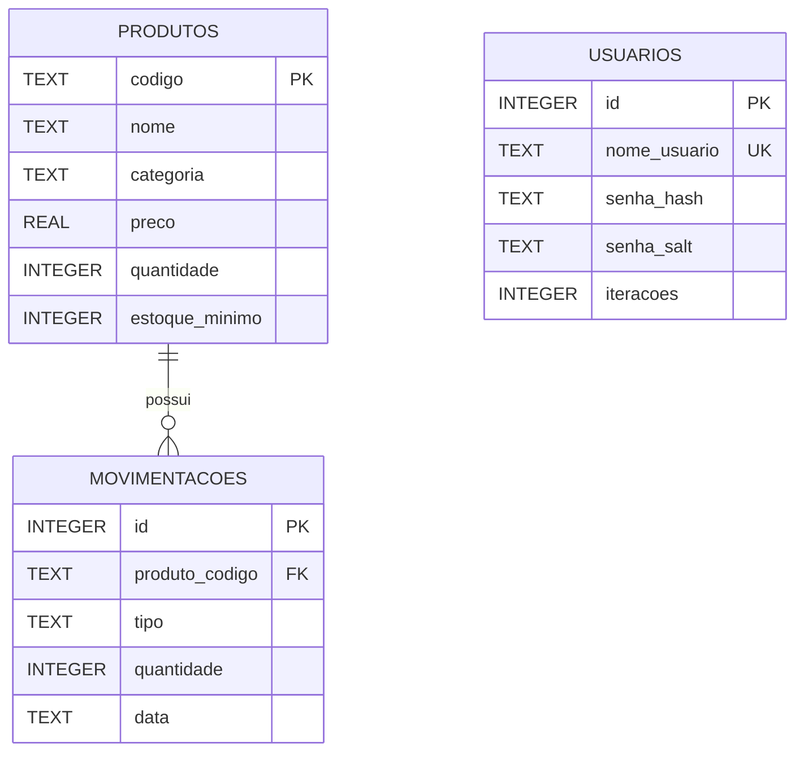

# Sistema de Controle de Estoque

Aplicação desktop em Python para cadastrar produtos, controlar entradas e saídas, consultar o saldo, acompanhar estoque baixo e exportar o relatório para CSV. O acesso é protegido por usuário e senha, e os dados ficam em um banco SQLite local.

## Requisitos

- Python 3.9 ou superior
- FreeSimpleGUI, Matplotlib e OpenCV contrib (instalados pelo `requirements.txt`)
- Webcam conectada e permissão do sistema operacional para usar o leitor de código de barras

## Como executar

No terminal, a partir da pasta do projeto:

```powershell
py -m venv .venv
.\.venv\Scripts\Activate.ps1
pip install -r requirements.txt
python main.py
```

O arquivo `estoque.db` é criado automaticamente na primeira execução. Para usar outro caminho de banco, defina a variável de ambiente `ESTOQUE_DB_PATH`.

## Funcionalidades

- Cadastro de produtos com código único, nome, categoria, preço e estoque mínimo.
- Registro de entradas e saídas com validação da quantidade e do saldo disponível.
- Consulta do estoque atual e filtro por categoria.
- Dashboard com quantidade de produtos, unidades, alertas e valor total em estoque.
- Gráfico de barras Matplotlib para visualizar os maiores saldos e destacar itens abaixo do mínimo.
- Histórico recente de movimentações.
- Exportação do estoque atual para CSV.
- Triggers SQLite que atualizam o saldo e bloqueiam saídas sem saldo suficiente.
- Login local: no primeiro acesso, crie o administrador. Senhas são armazenadas como hashes PBKDF2-SHA256 com salt individual.
- Backup consistente do SQLite a cada inicialização, salvo na pasta `backups/`; são mantidas as dez cópias mais recentes.
- Leitura de código de barras pela webcam; pressione `Q` ou `Esc` na janela da câmera para cancelar.

## Estrutura

```text
main.py                    Inicialização da aplicação
banco.sql                  Tabelas, índices e triggers
banco/
  conexao.py               Conexão e inicialização SQLite
  produtos.py              Cadastro e consultas de produtos
  movimentacoes.py         Entradas, saídas e histórico
interface/
  menu_principal.py        Interface FreeSimpleGUI
utilitarios/
  autenticacao.py         Cadastro e login com senha derivada e salt
  backup.py               Backup SQLite com retenção
  codigo_barras.py        Scanner via webcam
  validacoes.py            Validações compartilhadas
  exportacao.py            Exportação para CSV
  relatorios.py            Indicadores do dashboard
tests/
  test_estoque.py          Testes automatizados
```

## Diagrama do banco



O saldo atual fica em `produtos.quantidade`. Cada registro em `movimentacoes` é inserido com um tipo (`entrada` ou `saida`); o trigger `movimentacao_atualiza_estoque` atualiza o saldo. O trigger `movimentacao_saida_com_saldo` rejeita uma saída maior que o saldo disponível.

O banco e os backups podem ser direcionados usando `ESTOQUE_DB_PATH`; os backups ficam na pasta `backups/` ao lado do arquivo do banco. A webcam é aberta apenas quando o botão de leitura é acionado.

## Testes

Os testes usam um banco SQLite temporário e não alteram o banco da aplicação:

```powershell
python -m unittest discover -s tests -v
```

## Publicação no GitHub

Crie um repositório público no GitHub, adicione esta pasta como repositório Git e publique os arquivos. Para atender ao requisito de oito commits, divida o histórico de desenvolvimento em commits reais e descritivos; não crie commits artificiais ou sem alterações relevantes.
